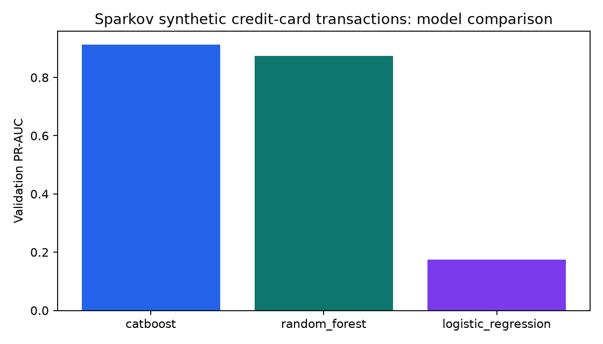
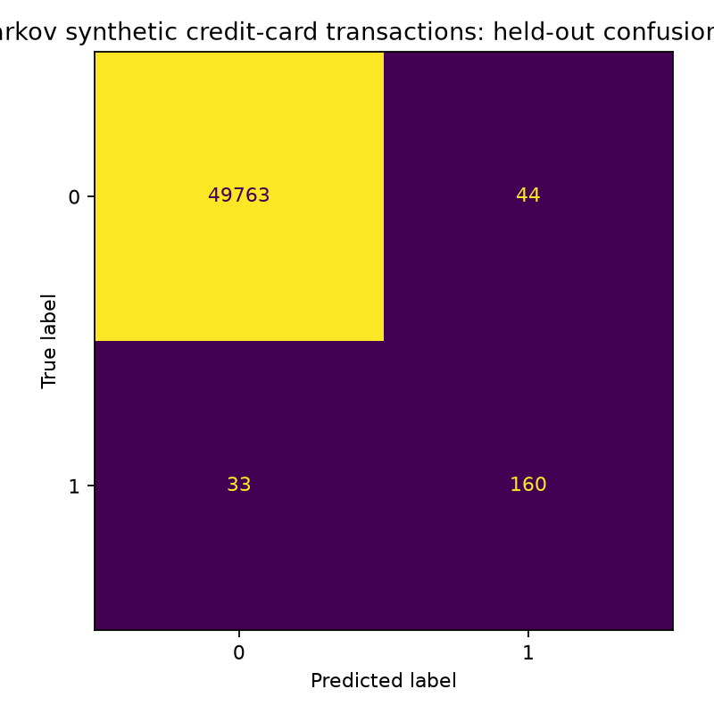

# Sparkov Synthetic Credit-Card Fraud ML

Standalone PyCharm project for the Sparkov synthetic transaction dataset. It compares class-weighted
logistic regression, random forest, and CatBoost, selects by validation PR-AUC, and evaluates once on the
later official test period. CatBoost keeps the dataset's categorical fields native instead of one-hot
expanding them.

## Dataset

- [Kaggle source](https://www.kaggle.com/datasets/kartik2112/fraud-detection)
- Synthetic data generated with Sparkov; distributor licence: CC0 1.0
- Provided files: `fraudTrain.csv` and `fraudTest.csv`

No raw customer names, addresses, card numbers, transaction IDs or merchant names are used as model features.

## PyCharm setup

Open the whole `sparkov-fraud-ml` folder, create a Python 3.11 virtual environment, then run:

```bash
python -m pip install --upgrade pip
python -m pip install -e ".[dev]"
```

Place the files here:

```text
data/raw/fraudTrain.csv
data/raw/fraudTest.csv
```

Run:

```bash
python preprocess_data/run.py
python training_model/train.py
python evaluation/evaluate.py
python -m fraudbench.inference examples/sample_transaction.json
python -m uvicorn fraudbench.api:app --host 127.0.0.1 --port 8040
```

Open <http://127.0.0.1:8040/docs> for the API.

## Folder guide

| Folder | Contents |
|---|---|
| `dataset` | Provenance, licence and required filenames |
| `preprocess_data` | Data validation and feature-engineering entrypoint |
| `preprocessed_df` | Generated train-ready table |
| `training_model` | Training entrypoint |
| `checkpoint` | `.joblib` model and model card |
| `evaluation` | Evaluation entrypoint |
| `outputs` | Metrics CSV/JSON and PNG charts |
| `utils` | Team helper scripts |

Some files are intentionally short: entrypoints call the reusable implementation under `src/fraudbench`, and `.gitkeep` preserves empty folders.

## Leakage controls

- The original training file is split chronologically for development and validation.
- The later official test file is untouched until final evaluation.
- Sampling happens after the temporal split and preserves the class ratio.
- Preprocessing is fitted only inside each scikit-learn training pipeline.
- Identity fields are excluded to prevent memorisation.

## Citation

Brandon Harris, *Sparkov Data Generation*, and Kartik Shenoy, *Credit Card Transactions Fraud Detection Dataset*.

## Current trained result

CatBoost was selected with validation PR-AUC **0.9130**. On the later 50,000-row test sample it achieved
PR-AUC **0.8643**, ROC-AUC **0.9908**, precision **0.7843**, recall **0.8290**, and F1 **0.8060**. See
[`outputs/metrics.json`](outputs/metrics.json) and [`outputs/model_comparison.csv`](outputs/model_comparison.csv).




